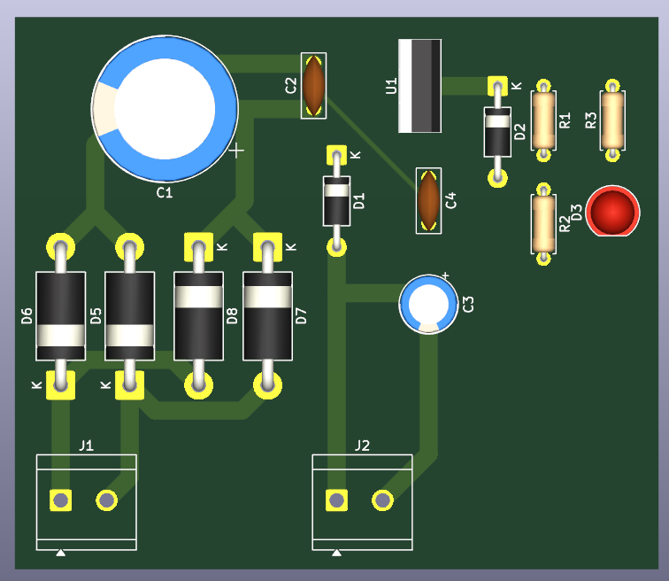

# 15 V / 2 A Linear DC Power Supply (LM350) - KiCad Design Study

A transformer-based, regulated 15 V / 2 A DC supply designed in KiCad as a learning project. The goal was to recreate a commercial plug-in AC-DC adapter. The design works on paper and passes ERC and DRC, but comparing it with the real adapter showed that a linear supply is the wrong architecture for a compact, low-cost product. This README documents the design and, more importantly, why it was not taken to fabrication.



## Project status

| Item | Status |
|---|---|
| Schematic | Complete, ERC clean |
| PCB layout | Complete, DRC clean |
| Gerbers and drill files | Generated (`fabrication/`) |
| Fabricated and tested | **No. Design only.** |
| Decision | Not fabricated, for cost and size reasons (see below) |

## Specifications

| Parameter | Value |
|---|---|
| Input | 18 V AC from an external 230 V isolating transformer (3 A secondary) |
| Output | 15 V DC, up to 2 A |
| Regulator | LM350 adjustable (TO-220) |
| Rectifier | Bridge of 4 x 1N5408 |
| Bulk filter | 4700 uF / 35 V |
| Board size | 71.1 mm x 63 mm, two layers |
| Connectors | 2 x 5.08 mm screw terminals (AC in, DC out) |

No mains voltage reaches the PCB. Mains connects only to the off-board transformer primary.

## How it works

```
230 V AC -> Transformer (off-board) -> 18 V AC -> J1
   -> Bridge rectifier (D5-D8) -> C1 bulk filter (~24 V DC peak)
   -> C2 input bypass -> U1 LM350 -> C3/C4 -> J2 (15 V out)
```

- **Bridge and C1** convert the 18 V AC to rippled DC of about 22-24 V.
- **U1 (LM350)** holds 1.25 V between its output and ADJ pins. R1 = 120 ohm and R2 = 1.3 kohm set the output: Vout = 1.25 x (1 + R2/R1), about 14.8 V.
- **D1** (output to input) and **D2** (ADJ to output) protect the regulator from capacitor discharge if the input collapses.
- **C2, C3, C4** provide input bypass, output stability and ADJ ripple reduction.
- **R3 + LED** give a power indicator.

## Key design decisions

| Decision | Reason |
|---|---|
| LM350 instead of 7815 | 78xx parts are limited to 1.5 A; 2 A needed an adjustable 3 A part |
| 1N5408 bridge diodes | 3 A rating; 1N4007 (1 A) is too small for 2 A with capacitor-input peaks |
| 18 V AC secondary | Gives enough headroom (about 3 V) above 15 V under load and mains dips |
| Off-board transformer | Keeps mains off the PCB, so no creepage/clearance issues and a safe board to handle |
| 2 mm tracks on power paths | Sized for 2 A on 1 oz copper; thin 0.5 mm tracks on mA-level signal nets |

## Why I did not build it (the learnings)

### 1. The PCB alone was larger than a commercial adapter

The commercial 12 V / 2 A adapter I wanted to match measures about **7.8 cm x 4.7 cm**, including its plastic case and mains pins. My bare PCB measures **7.1 cm x 6.3 cm**, before adding the transformer, heatsink and enclosure.

The reason is architecture, not layout quality:

- The adapter is a **switch-mode power supply (SMPS)**. It rectifies mains directly and switches at tens of kHz, so its transformer is a tiny ferrite part.
- My design is a **linear supply**. It needs a 50 Hz transformer (large and heavy), a 4700 uF bulk capacitor, large 1N5408 diodes, and a heatsink for the regulator.
- The LM350 dissipates roughly (Vin - Vout) x I, about 14 W or more at full load, so the regulator needs a large heatsink and ventilation.

### 2. The transformer alone cost more than the complete adapter

A suitable 18 V / 3 A isolating transformer costs about **Rs 1500**. The finished commercial adapter costs about **Rs 450**. Before counting the PCB, regulator, heatsink, capacitors, fuse and enclosure, the design is already several times more expensive than the product it was meant to replace.

### Conclusion

For a compact, low-cost 12-15 V / 2 A adapter, a linear supply is the wrong choice. A **flyback SMPS** is the right architecture: smaller, cooler, and cheaper. A linear design still makes sense where low noise matters more than size and cost, such as a bench supply or an analogue project.

## Skills practised

- Schematic capture and ERC (including `PWR_FLAG` for power-input errors)
- Selecting footprints from datasheet dimensions (and catching wrong default footprints)
- Adjustable regulator design and protection diode orientation
- Net classes and trace widths sized to current
- Two-layer routing, vias and copper pours
- Reading DRC: clearance, shorting and unconnected-item violations
- Gerber, drill, BOM and PDF output
- Engineering trade-off analysis: linear vs switch-mode, cost, size and efficiency

## Repository structure

```
hardware/       KiCad project (.kicad_pro, .kicad_sch, .kicad_pcb)
DOCS/           Schematic PDF, PCB layout PDF, IMAGES, notes
fabrication/    Gerbers, drill files, zip
```

## Safety note

The transformer primary is connected to mains (230 V) and is dangerous. Anyone building this must use an enclosed, isolating transformer, a fuse on the primary side, and insulated wiring. The PCB itself carries only about 18 V AC and 15-24 V DC.

An earlier iteration of this project connected a rectifier directly to mains with no isolation. That approach was abandoned because it produces about 325 V DC that is live relative to earth and cannot give 12-15 V.

## Possible next steps

- Study and design a flyback SMPS (controller IC, ferrite transformer, optocoupler feedback)
- Build a smaller low-voltage project (for example 5 V regulator or sensor board) that can actually be fabricated and tested

## License

No license is specified. All rights are reserved by the author. This repository is shared for viewing and learning.
